# ComfyChair H3

English | [简体中文](README.md)

A native Android client for ComfyUI. Generate images and video, compose prompts, and manage assets on your phone; the server is still your own ComfyUI.

Android 13+ · GPL-3.0 · bring your own ComfyUI server

> Built on [ComfyChair](https://github.com/legal-hkr/comfychair) and released under GPL-3.0. Not affiliated with the ComfyUI team.

---

## At a glance

- **Images**: text to image and image to image on two tabs; editing and inpainting with a brush and feather control; up to 5 LoRAs per chain, strength -100 to 100
- **Video**: text to video, image to video, video to video on three tabs; separate high-noise and low-noise chains; source video up to 100 MB
- **H3 workspace**: 4 bundled templates, 4 modes that switch with the material you drop in; first frame, last frame, up to 9 references and 3 audio tracks; relay takes, auto-written last-frame declaration, second-pass refinement, presets, resumable jobs
- **Prompt tools**: 2625 words across 39 categories, split into SFW and NSFW libraries (SFW is 1518 words across 41 categories); four-act story composer with 4 cast sizes; optional rewrite by an external model
- **Visible progress**: a status lamp that shows connection and model inventory at a glance, a progress bar that reports the stage and elapsed time, and a sampling preview that plays as an animation — stop the moment it looks wrong
- **Keeps and hides**: the gallery cache survives a server restart (5 GB default cap), any result can be hidden with one tap, and memory-only mode leaves nothing on disk

---

## Screenshots

### Image generation and result control

<p align="center">
  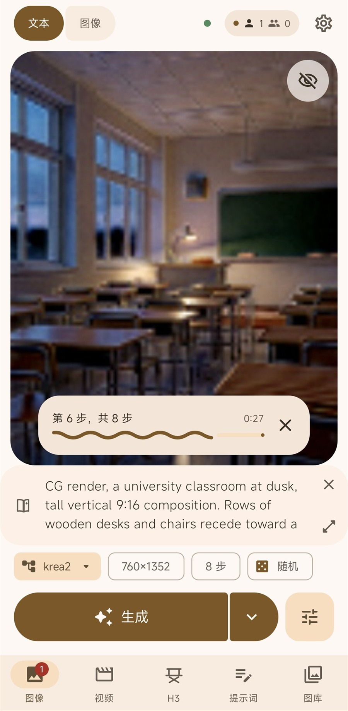
  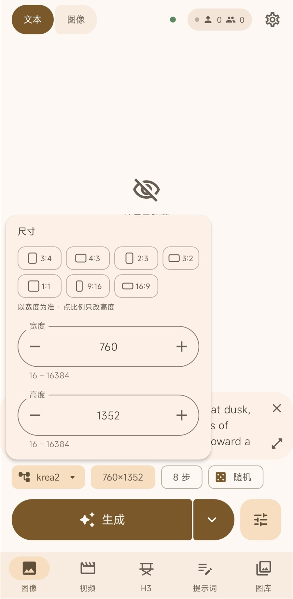
  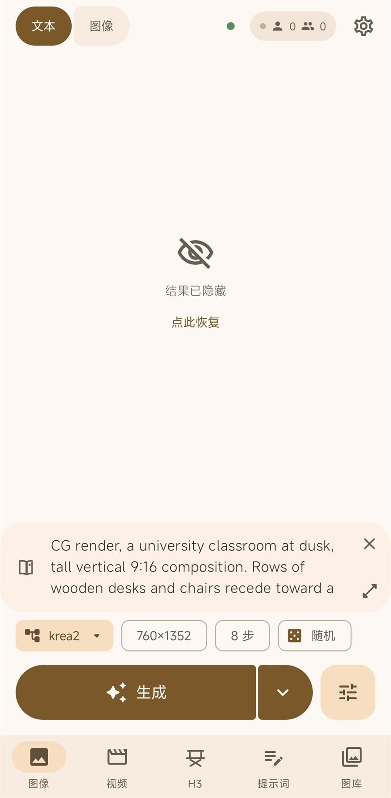
</p>

The hide control sits in the top-right corner while an image renders. The size panel applies a ratio in one tap and still accepts exact dimensions. One tap on the eye pulls the result off the screen and leaves "Result hidden / Tap to restore".

### H3 workspace

<p align="center">
  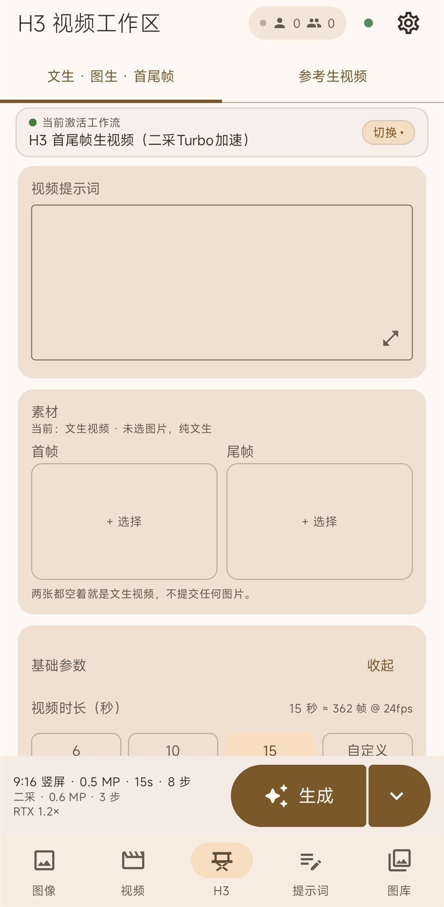
  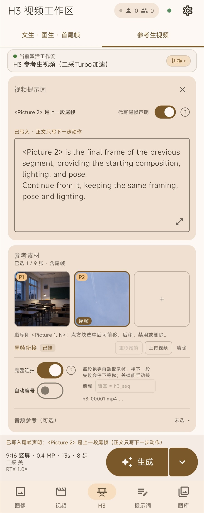
</p>

Left: the first/last-frame window. With both slots empty it is a text-to-video run, and the bar underneath reads "15 s = 362 frames @ 24 fps" as you change the duration.
Right: reference-to-video. Two references numbered P1 and P2, a last frame attached, the auto-written declaration turned on, relay takes and audio references all on one screen.

### Sampling preview

<p align="center">
  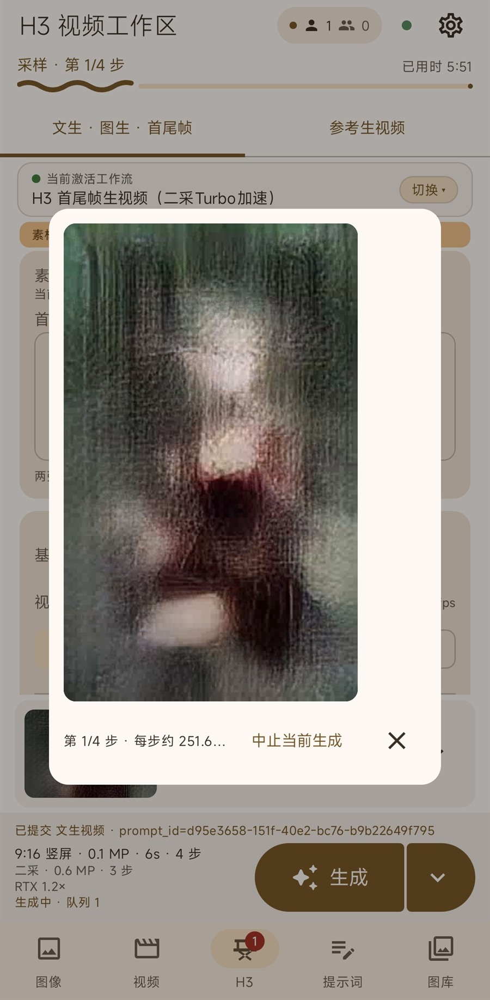
  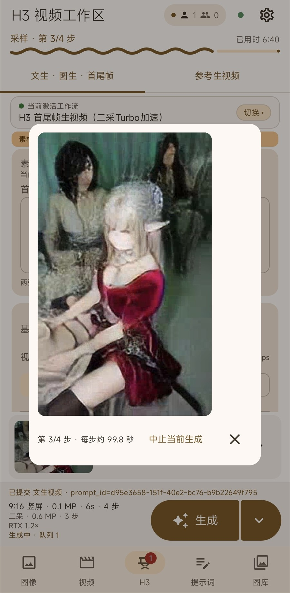
</p>

Step 1 and step 3 of the same run. The frame resolves out of noise while the title reports the step, the time per step and the elapsed time. Cancel at any point.

### Tags and gallery

<p align="center">
  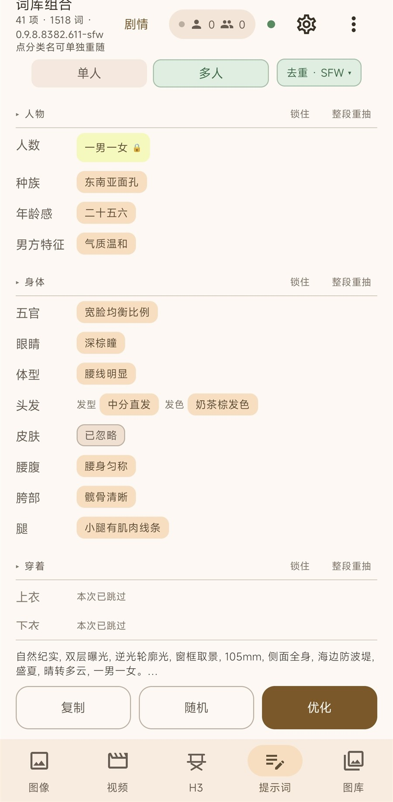
  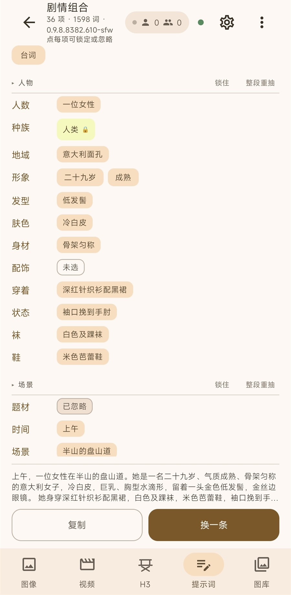
  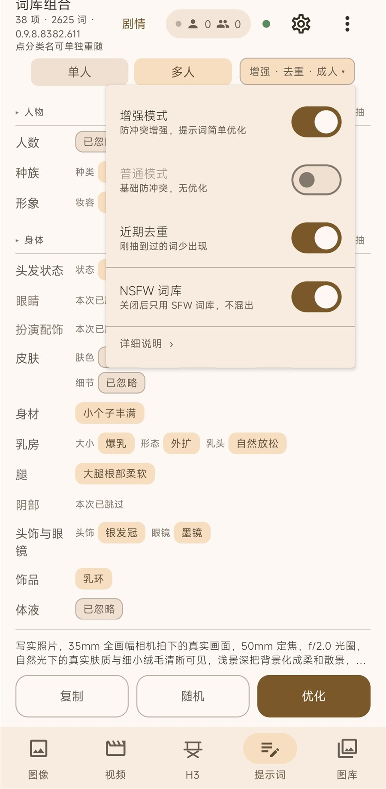
  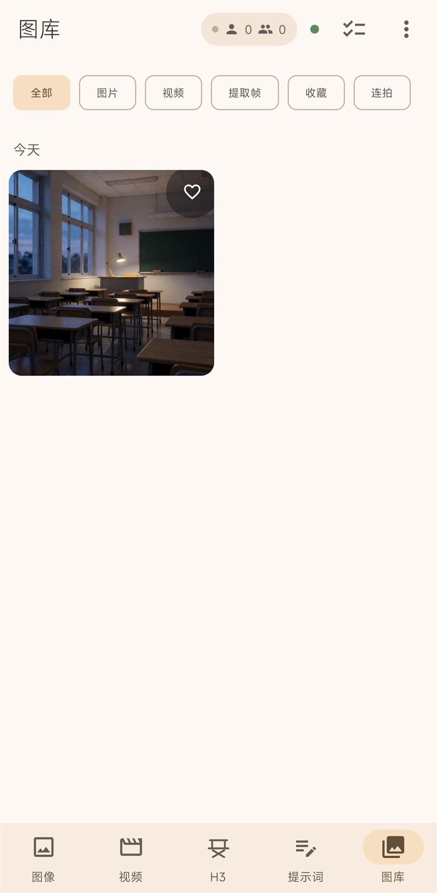
</p>

The tag composer on the SFW library (41 entries, 1518 words), the story composer, the NSFW library with its reinforcement switches, and the gallery filtered by type.

---

## H3 video workspace

A dedicated tab for MiniMax H3 work, from the first idea to a finished clip.

**Modes follow the material.** A first frame alone means image to video. Add a last frame and it becomes first-and-last-frame video. Text only is text to video. Drop in references and it is reference-to-video. You never pick a mode first and then fill it; the workflow is detected from its nodes, so your own H3 workflow works the same way.

**Material slots.** First frame, last frame, up to 9 references and up to 3 independent audio tracks. A reference can be disabled without being deleted, which makes it easy to try several compositions in turn. Audio can be reordered, replaced or removed track by track. Everything is numbered in submission order, matching the image references in the prompt.

**Relay takes.** Queue several segments at once and each one starts as soon as the previous finishes. Choose one-at-a-time or queue mode; in queue mode it shares the same queue as ordinary jobs, and the queue panel shows which segment is running.

**Auto-written last-frame declaration.** When you continue from a previous clip, the model has to know that the first image is the last frame of the previous segment, or it redraws the scene from scratch. The app can insert that sentence at the top of the prompt, checks for an existing one first (so it will not write a duplicate if you already did it by hand), and can take it back with one tap. If the prompt already declares a different picture number, it refuses to write and tells you to fix the prompt first.

**Second-pass refinement.** After the clip is done, run it through an upscale model once more, with its own target megapixels, step count and upscale model. The main sampling settings are untouched.

**Upscaling and frame interpolation.** A super-resolution multiplier and interpolation smoothing for resolution and motion.

**Parameter presets.** Save a full set of settings under a name and apply it next time in one tap, or save the current settings as a new version of the workflow while leaving the original alone.

**Pre-flight checks.** Missing first frame, too many references, out-of-range megapixels, dimensions that are not valid integers — all listed before submission instead of waiting for the server to reject the job.

**Resumable jobs.** The job id is written locally at submission. If the app is recycled, sent to the background or the phone is locked, reopening it reattaches to the running job instead of losing a clip that took a minute to render.

## Workflows: four built in, matching JSON included

Four phone-oriented H3 templates ship with the app, so it runs the moment you install it. The first two sample once. The last two are **two-pass**: a low-resolution pass first, then an upscale and a second refinement pass, which holds detail better at the same step count at the cost of one extra sampling run.

| Bundled template | Modes | Sampling |
|---|---|---|
| `ttv_h3_mobile_frames` | Text / image / first-and-last frame in one template | Single pass |
| `itv_h3_mobile_r2v` | Reference to video (several references + three audio tracks) | Single pass |
| `itv_h3_mobile_guide_turbo` | Text / image / first-and-last frame | Two-pass + Turbo |
| `itv_h3_mobile_r2v_turbo` | Reference to video | Two-pass + Turbo |

**The same four JSON files are in this repository**, so you can open them on a desktop first and see which node or model you are missing:

| File | Notes |
|---|---|
| [`workflows/ttv_h3_mobile_frames.json`](workflows/ttv_h3_mobile_frames.json) | Drag straight into ComfyUI |
| [`workflows/itv_h3_mobile_r2v.json`](workflows/itv_h3_mobile_r2v.json) | Drag straight into ComfyUI |
| [`workflows/itv_h3_mobile_guide_turbo.json`](workflows/itv_h3_mobile_guide_turbo.json) | Drag straight into ComfyUI; contains subgraphs |
| [`workflows/itv_h3_mobile_r2v_turbo.json`](workflows/itv_h3_mobile_r2v_turbo.json) | Drag straight into ComfyUI; contains subgraphs |

The two two-pass templates are built on **LokkenJP**'s TenEros two-pass examples (`H3_Turbo_2Pass_ErosMax_b7_simple_v7` and `advanced_refmods_v9` from [SampleWorkFlowTwoPassOptimized](https://huggingface.co/LokkenJP/TenEros_Max_optimized_learned/tree/main/SampleWorkFlowTwoPassOptimized)): two `BasicScheduler` + `SamplerCustomAdvanced` pairs, the first producing a low-resolution result, `MiniMaxH3LatentUpscaleWithModel` scaling it up before the second pass, `MiniMaxH3SigmaShift` aligning the noise schedule, and `LokkenVideoPostProcessing` at the end. The templates were redrawn for phones and the two passes sit inside a subgraph, so nodes and links do not map one-to-one onto the examples — reselect the models for your own server before use.

The UNET and LoRA names inside the bundled templates are the filenames from the machine they were built on, so they will not match yours. Two ways forward:

- Keep the bundled template and reselect the files on your server under "Models and LoRA";
- Or drag the JSON from `workflows/` into ComfyUI, where a missing node fails loudly and a missing model is visible in the loader.

All four are in **ComfyUI UI format** (`nodes` / `links`), so they open when dropped into the web app. The app stores the same graphs in **API format**, which is what gets submitted. The two two-pass templates keep both passes inside a subgraph and need a ComfyUI build with subgraph support — all four open without errors on 0.46.1.

To import a workflow someone shared: Workflow management → Import JSON → pick the file. Bundled or imported, **reselect UNET / CLIP / VAE / LoRA from your own server**, otherwise the job fails with a missing-model error.

### Required custom nodes

These templates use the following node packs. Missing any one of them produces an unknown-node error on import or submission.

| Node pack | Nodes used |
|---|---|
| MiniMax H3 nodes | `MiniMaxH3ImageToVideo`, `MiniMaxH3ReferenceToVideo`, `MiniMaxChunkFeedForward`, `MiniMaxLowVRAMAttention`, `MiniMaxH3MemoryEfficientSageAttentionPatch` |
| ComfyUI-KJNodes | `ModelPreviewOverrideKJ`, `PathchSageAttentionKJ` |
| rgthree | `Power Lora Loader`, `Display Any` |
| ComfyUI-Easy-Use | `easy seed`, `easy cleanGpuUsed`, `easy clearCacheAll` |
| VideoHelperSuite | `VHS_VideoCombine`, `VHS_LoadAudioUpload` |
| Other | `ComfyMathExpression`, `ResolutionSelector`, `CR Text`, `VRAM_Debug`, `ApplyMiniMaxH3FirstBlockCache` |
| Two-pass templates only | `MiniMaxH3LatentUpscaleWithModel`, `LatentUpscaleModelLoader`, `MiniMaxH3SigmaShift`, `LokkenVideoPostProcessing`, `RTXVideoSuperResolution` |

### About the speed-up nodes

The sample workflows ship with a stack of accelerators so they fit on modest hardware. **None of them is required**, and removing them does not change correctness:

- **4-step LoRA** (`...turbo_4step_v1.2_768p...`): `LoraLoaderModelOnly` at strength 1.0, pushing sampling down to 4 steps. Swap it or drop it and raise the steps back to around 20
- **SageAttention patches** (`PathchSageAttentionKJ` + `MiniMaxH3MemoryEfficientSageAttentionPatch`): saves memory and time, needs SageAttention installed; delete both nodes if you do not have it
- **First-block cache** (`ApplyMiniMaxH3FirstBlockCache`): only in the first-and-last-frame template, reuses attention blocks across steps
- **Easy-Use cleanup** (`easy cleanGpuUsed`, `easy clearCacheAll`): releases VRAM after each run
- **Low-VRAM attention** (`MiniMaxLowVRAMAttention`): skip it when you have enough memory

## Prompt engine

**Tag composer**: a library of 2625 words across 39 categories (SFW is 1518 words across 41), drawn per slot and joined into a single prompt.

- Separate single and multi-person structures; the cast size follows your choice
- Reroll one category by name, or the whole section
- Lock a slot so it stays out of rerolls
- Conflicting words grey out automatically, so "bare lower body" never lands beside "long dress"
- Skip an individual slot for this round
- Tap a word to complete it, with recently used words close at hand
- Three quality settings: enhanced (stronger conflict handling plus light prompt cleanup), standard (base conflict handling), and recent-word avoidance
- An NSFW library switch; turn it off and only SFW words are drawn, never mixed
- Positive and negative prompts kept apart, each copyable on its own
- Import (merge or replace), export, or restore the bundled library

**Story composer**: 4 cast sizes (solo, one man and one woman, one man and two women, two women) and four-act narrative templates that arrange people, setting, action and dialogue into a complete scene. Reroll any section, turn dialogue off, and use the separate second-woman field group in multi-person casts. The full story can be viewed and copied.

**Prompt optimization**: connect an external model to rewrite a prompt. Supply the endpoint, model name and key yourself, send a composer result over in one tap, and keep a history so you can compare before and after.

## Image generation

- **Text to image**: prompt straight to image, positive and negative edited separately, with a generate button inside the full-screen editor
- **Image to image**: editing mode for style transfer with up to 2 references; inpainting with a mask, adjustable brush size and edge feather
- **Source and result**: swap the small previews; the source has its own toolbar for replace, remove and mask
- **Parameters**: seed, steps, size and scale in the bottom row, opening into a full options panel; the plus and minus buttons step along the values the node allows
- **Size**: seven preset ratios applied in one tap, or exact width and height; ratio and megapixels are alternatives
- **LoRA**: up to 5 per chain, strength -100 to 100, coarse stepping plus a fine slider; checkpoint and UNET workflows each keep their own chain
- **Results**: page through a batch with a thumbnail strip; one menu saves, shares, shows the generation parameters, or sends the image to another screen

## Video generation

- **Text to video**: prompt only, with high-noise and low-noise models and LoRAs chosen separately
- **Image to video**: bring a still to life, with adjustable duration and frame rate
- **Video to video**: restyle, restore or upscale; the source comes from the phone or an existing result, up to 100 MB; it plays in the preview area and swaps with the result
- **Length and frames**: aligned to the frame grid declared by the workflow's nodes (4n+1 for Wan, 17n+5 for H3), with duration, frame rate and frame count kept in step and no cap imposed by the app
- **Playback**: sound, scrubbing that moves the picture with it, frame stepping, and a loop switch that is remembered

## Run status

**Status lamp**: one small lamp in the same corner on every screen.

- Green: the server is reachable, the model inventory and node parameters are loaded
- Amber with "Connecting": the phone is reaching the server
- Amber with "Reading": connected, counting models, LoRAs and VAEs
- Red with "Offline": cannot reach the server
- Red with "Read failed": connected, but the parameters cannot be read

Tap it to open a card with the address, the connection state, whether node parameters are ready, and how many models, LoRAs, text encoders and VAEs the server reports.

**Progress bar**: a thin line under the title, stage on the left, elapsed time on the right.

Stages advance in real order: preparing → loading models → sampling → decoding → muxing video → writing the file. Only sampling reports a real step count (step 3 of 20); the other stages have nothing countable, so the bar animates instead of inventing a percentage. If the connection drops for more than a second and a half, the right side reads "12 min elapsed · Reconnecting", which tells you the number stopped moving because the phone is reconnecting, not because the job died.

**Sampling preview**: the picture appears while it is being made, resolving from noise into a figure and then a face.

- Labelled "Sampling preview · step 8 of 20"
- Shows the time per step, so you can estimate what is left
- Expandable, and collapsible to a single line ("Sampling preview off · Tap to restore")
- **Cancel the current run** right there
- Intermediate frames play as an animation, so motion and posture can be judged before the clip finishes

## Privacy and storage

**Hiding results**: the eye icon in the top-right corner of the image and video previews pulls the finished piece off the screen and leaves "Result hidden / Tap to restore". No files are deleted, the gallery is untouched and the queue keeps running. Each workspace remembers its own state across restarts, and the next submission opens the preview again automatically.

**Memory only**: generated media is not written to disk by default and is cleared on exit; saving on exit or writing to the device are opt-in. In memory-only mode the system task switcher shows no preview.

**Cache and favourites**: thumbnails and full-size images are cached separately, evicted least-recently-used past the cap (5 GB default, adjustable). Favourites are never evicted, and clearing removes only what is not favourited, reporting how much space that frees.

**Still usable after a server restart**: ComfyUI keeps its history in memory, so a restart empties it — but the phone's cache is still there.

- Entries with a local copy become "local only" and stay in the gallery
- Picking from "Past results" reads the original from the gallery cache and re-uploads it as a server input asset
- Re-uploaded assets live in their own subfolder of the server's input directory, so a deleted original or a cleared history no longer matters

As long as the cache is there, those assets can still be selected, used and submitted. If the cache was evicted and the server has also cleared the file, selecting the entry says so instead of failing silently.

## Queue and recovery

**Queue**: the counter in the top bar keeps your jobs and other clients' jobs apart. The queue panel cancels, pins and removes your jobs, shows other clients' jobs with their progress and position without letting you change them, and can clear everything. The same queue serves both ordinary generations and H3 relay takes.

**Resumable jobs**: the job id is written locally at submission, so a job survives the app being recycled, backgrounded or the phone locked.

## Gallery

- Adaptive grid, collapsing top bar, pull to refresh, duration shown on video
- Filter by type: all, images, video, extracted frames, favourites, relay takes
- Long-press to select, then save, share or delete in bulk; other results from the same job are flagged, because the server deletes by whole job
- Open an item for its generation parameters: prompt, model, seed, steps
- Deletion can be undone for a few seconds before it reaches the server
- Extracted frames are grouped separately and can be saved, shared or used as material

## Server and connection

- **Multiple servers**: store several ComfyUI instances, each with its own settings and optional automatic sign-in
- **Protocol**: HTTPS and HTTP both work, HTTPS preferred; a server that has been used over HTTPS never drops to plain HTTP without confirmation
- **Certificates**: system-trusted certificates pass straight through; a self-signed or private CA asks you to confirm its SHA-256 fingerprint once, and only that certificate is accepted afterwards
- **Authentication**: HTTP basic auth, API key or bearer token, and browser single sign-on behind a reverse proxy
- **Offline mode**: offered automatically when the server cannot be reached, letting you browse what is already on the phone
- **Server check-up**: ComfyUI, OS, Python and PyTorch versions, RAM and VRAM use, and one-tap free memory, unload models and clear server history

## Workflow editor

- **Four modes**: node graph (read-only), node values, structural editing, field mapping
- **Node graph**: ComfyUI colours adapted to light and dark themes, Bézier or Hermite links; below 40% zoom nodes become title blocks that expand on tap; the selected node's links are emphasised and the rest recede
- **Node values**: every editable input on a node, changes marked individually, revert one or all
- **Node management**: browser by category tree or by name; add, remove, duplicate, bypass, rename and clean up orphaned nodes; socket menus connect, insert a compatible node, or disconnect
- **Groups and notes**: frosted group backgrounds, Markdown in notes
- **Subgraphs**: define once, use in several places; create from a selection, unpack, add or remove sockets, manage exposed values
- **Field mapping**: assign each field's source on import, with one field able to draw on several nodes or none
- **Custom fields**: promote any node value — including inside a subgraph — to its own field, with a control matching its type, validation before generation and per-workflow memory
- **Three formats**: ComfyUI UI format, ComfyUI API format and ComfyChair's own, all importable and exportable
- **Workflow list**: filter and enable or disable, with each workflow remembering its own parameters

## Settings and updates

- **Server**: connection, certificates, model list refresh
- **Generation**: default parameters, media and privacy, language, workflow editor
- **Data**: backup and restore (connections, workflows, custom settings, never passwords or tokens), cache clearing, debug log, reset to a fresh state while keeping servers
- **Updates**: an in-app check against the published release, comparing version codes rather than version strings, once a day; release notes ship in the package in both Chinese and English and follow the system language

## Getting started

**1. Install.** Download the APK from the releases page. The package name differs from the upstream app, so both can be installed side by side.

**2. Connect.** Enter the server address and port (for example `http://192.168.1.10:8188`). Servers with a password or token ask for it here; behind a reverse proxy that needs a login, choose browser sign-in. A self-signed certificate asks you to confirm its SHA-256 fingerprint once.

**3. Wait for a green lamp.** When the lamp turns green the model list and node parameters are loaded and generation can start. If it is red, open the card first instead of tapping generate.

**4. Pick a workflow.** The H3 tab uses a bundled template by default, but its UNET and LoRA names come from the machine it was built on, so reselect them under "Models and LoRA". Other workflows can be imported from Workflow management.

**5. Make the first clip.** Write the prompt, then place material according to the mode: a first frame alone gives image to video, adding a last frame gives first-and-last-frame video, and nothing at all gives text to video. Once submitted, the progress bar reports the stage and the sampling preview shows the picture forming.

**6. Find the result.** It is in the gallery and in the preview area; the eye icon pulls it off the screen. Favourite anything you want to keep, since favourites are never evicted from the cache.

## Requirements

- Android 13 (API 33) or newer
- A reachable ComfyUI server
- A network path between the phone and the server (LAN, tunnel or reverse proxy all work)

## Building

```bash
./gradlew :app:assembleRelease
```

Release builds need a signing configuration. Debug builds install directly, but they share the release package name, so the two cannot coexist.

## Companion tool

**Browser composer**: the same tag and story engine as a local web page, for composing prompts on a large screen and copying them out. All four libraries (main, SFW main, story, SFW story) match the app exactly and are compared file by file by a checking script — an unsynced change on either side fails the check.

## Known limits

- Hiding results is wired into the five image and video generation screens; the H3 workspace does not have it yet
- The local cache defaults to 5 GB and is adjustable in settings; past it, entries are evicted least-recently-used except favourites
- Assets copied to the server cannot be cleaned up by the client, since ComfyUI exposes no delete endpoint; a dedicated subfolder and hash-based filenames keep the growth bounded
- A single reference is capped at 32 MB, an audio track at 64 MB, and a source video at 100 MB
- The tag and story libraries are bundled resources: raise the library version whenever you change them, or an upgrade keeps reading the copy already on the phone

## Project info

| | |
| :--- | :--- |
| Version | 0.9.8.8382.617-h3 (version code 377) |
| Platform | Android 13 (API 33) and newer |
| Package | `com.comfychair.h3` |
| Base | [ComfyChair](https://github.com/legal-hkr/comfychair) (GPL-3.0) |
| Bundled workflows | 4 H3 templates: text, image, first-and-last frame, reference to video, two of them two-pass Turbo |
| Tag library | 39 categories, 2625 words; SFW 41 categories, 1518 words |
| Story library | 4 cast sizes, 4 four-act templates; 1404 NSFW words, 1598 SFW words |
| Content rating | SFW and NSFW libraries side by side; the NSFW switch controls which one is drawn, and turning it off keeps everything SFW |

## Changelog

See [CHANGELOG.md](CHANGELOG.md) for what changed in each version.

## Licence and credits

Built on [ComfyChair](https://github.com/legal-hkr/comfychair), released under GPL-3.0.

ComfyUI remains the property of its respective owners. This is an independent community project with no affiliation with or endorsement by the ComfyUI team.
