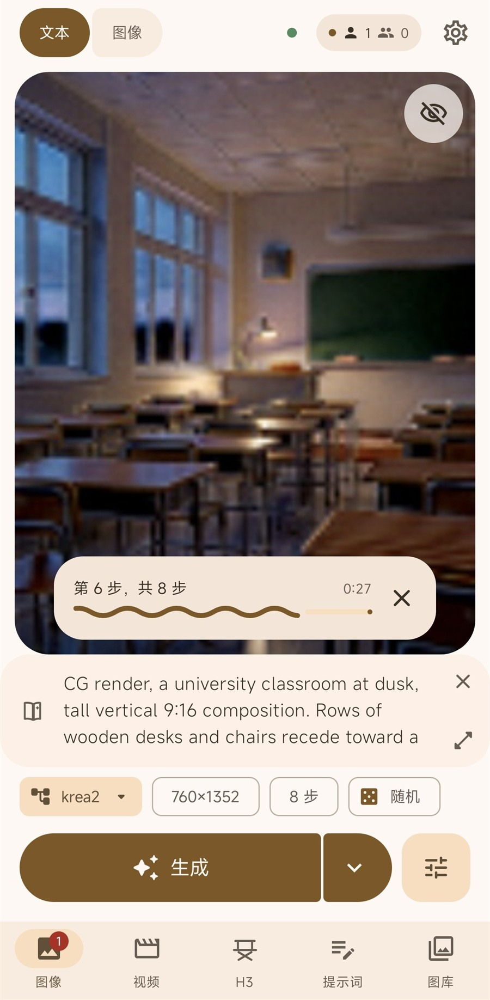
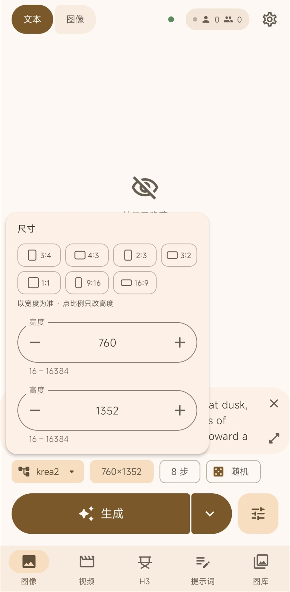
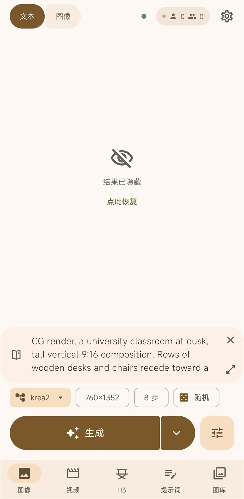
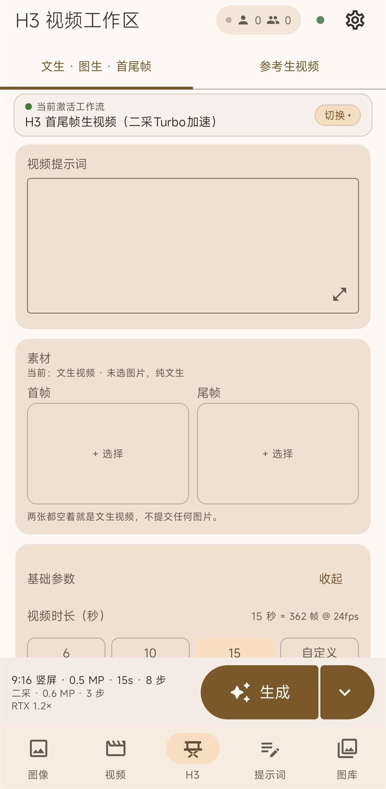
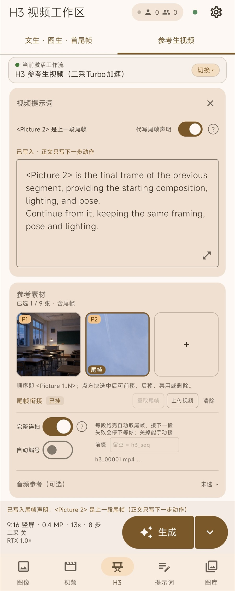
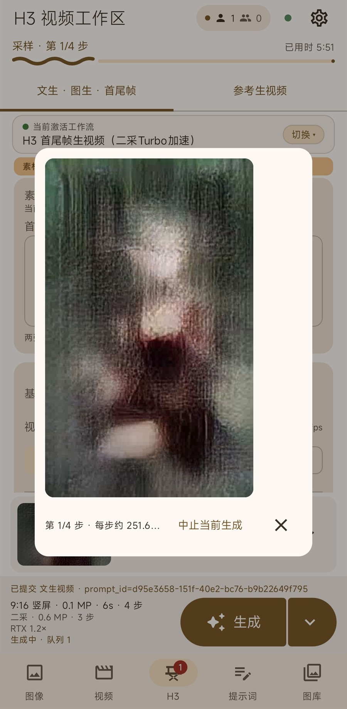
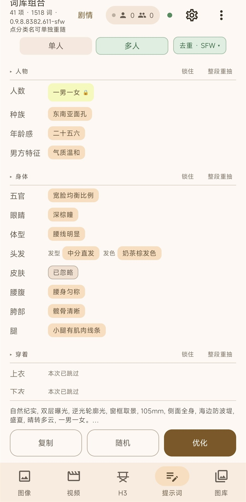
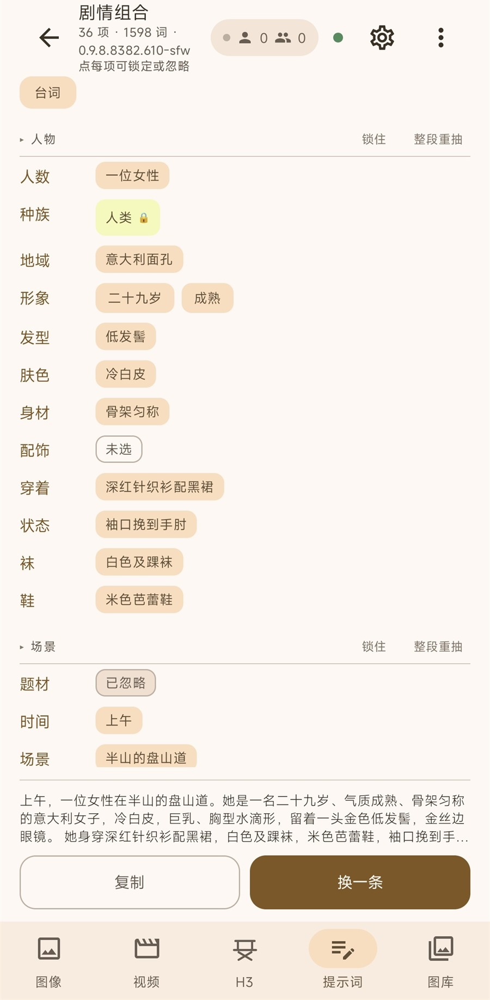
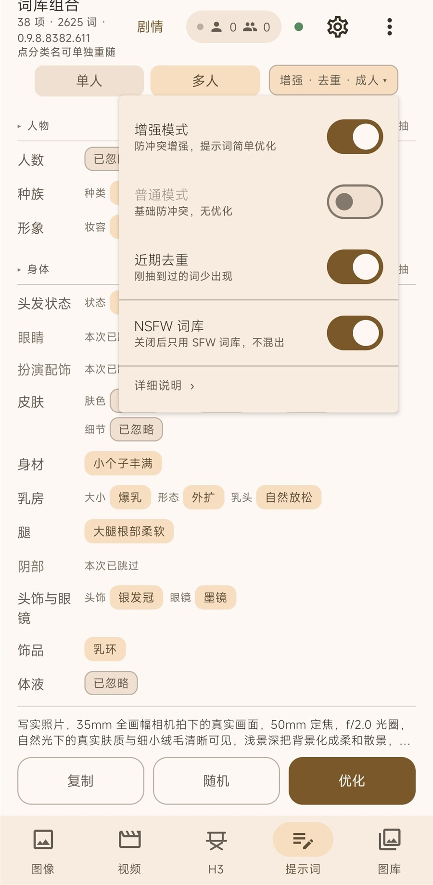
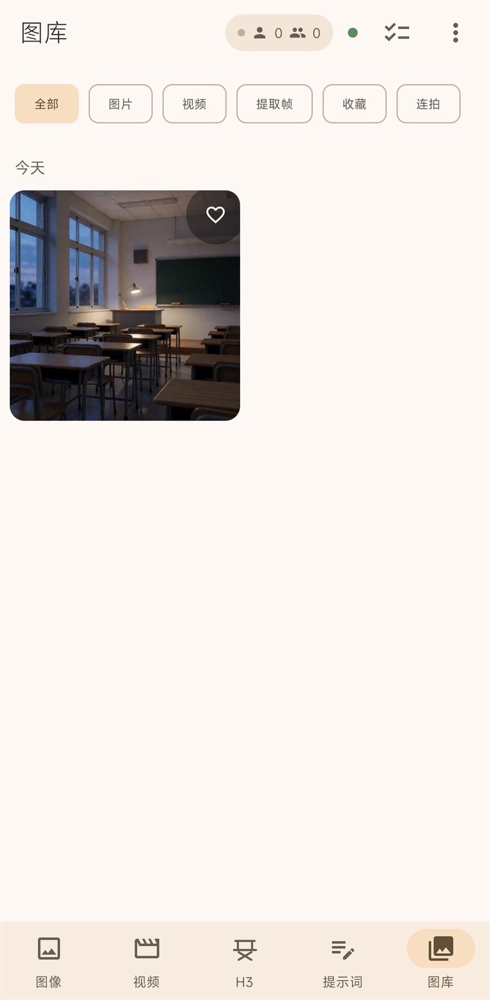

# ComfyChair H3

[English](README.en.md) | 简体中文

面向 ComfyUI 的原生 Android 客户端。出图、出视频、写提示词、整理素材都在手机上完成，服务端仍是你自己的 ComfyUI。

Android 13 及以上 · GPL-3.0 · 服务端自备 ComfyUI

> 本项目基于 [ComfyChair](https://github.com/legal-hkr/comfychair) 二次开发，遵循 GPL-3.0 协议发布，与 ComfyUI 官方团队无关。

---

## 功能速览

- **出图**：文生图、图生图两页；图生图分编辑与局部重绘（笔刷 + 羽化）；LoRA 链最多 5 个，强度 -100 至 100
- **出视频**：文生、图生、视频转视频三页；视频按高噪 / 低噪分链，源视频上限 100 MB
- **H3 工作区**：4 套内置模板、4 种模式自动切换；首帧、尾帧、最多 9 张参考图、最多 3 路音频；连拍、代写尾帧声明、二采精修、参数预设、断点续跑
- **提示词随机标签**：2625 词 / 39 类词库，分 SFW 与 NSFW 两档（SFW 档 1518 词 / 41 类）；四幕剧情 4 个人数档；可接外部大模型改写
- **看得见进度**：状态灯一次看清连接与模型清单，进度条报阶段与耗时，采样预览串成动图，不对就停
- **留得住藏得起**：缓存扛得住服务器重启（默认上限 5 GB），结果一键隐藏，也可以只存内存、退出即清

---

## 界面预览

### 生图与结果控制

<p align="center">
  
  
  
</p>

出图时右上角留有隐藏入口；尺寸面板用比例一键套用，也可以直接填宽高；点一下眼睛，成品从屏幕上撤下，原地只留「结果已隐藏 / 点此恢复」。

### H3 工作区界面

<p align="center">
  
  
</p>

左：首尾帧窗口，两张都空着就是文生视频，底部实时显示「15 秒 = 362 帧 @ 24fps」。
右：参考生视频，两张参考图按 P1、P2 编号，尾帧已挂、代写尾帧声明已开启、完整连拍与音频参考都在同一屏。

### 采样预览

<p align="center">
  
  
</p>

同一次生成的第 1 步与第 3 步。画面从噪点渐显，标题栏写明步数、每步耗时与已用时间，随时可以中止。

### 随机标签与图库

<p align="center">
  
  
  
  
</p>

词库组合的 SFW 档（41 项 / 1518 词）、剧情组合、NSFW 档与强化开关、图库按类型筛选。

---

## H3 视频工作区

独立页签，面向 MiniMax H3 的视频创作，从想法做到成片。

**四种模式自动识别**：只放首帧是图生视频，放了尾帧是首尾帧视频，只有文字是文生视频，放了参考图是参考生视频。改素材即改模式，不需要先选模式再填内容。工作流按内部节点自动识别，导入自己的 H3 工作流同样可用。

**素材位**：首帧、尾帧、最多 9 张参考图、最多 3 路独立音频。参考图可单独「禁用」而不删除，方便在几种构图间来回试；音频支持调整顺序、替换、逐段删除。所有素材按提交顺序编号，与提示词里的图片引用一一对应。

**连拍**：一次排入多段，前一段跑完自动接上下一段。可选「一次只跑一条」或「排队模式」，排队时与普通任务共用同一队列，队列面板里能看到第几段在跑。

**代写尾帧声明**：接续拍摄时，模型需要知道第一张图是上一段的最后一帧，否则会把画面重画一遍。本版可自动在正文开头补上这句声明，写入前先查重（你已经手写过就不重复写），也能一键撤回；若正文里已有的声明编号与本次尾帧不一致，会拒绝写入并提示先改正文。

**二采精修**：成片之后用放大模型再走一遍，单独设置目标像素、采样步数、放大模型，不影响主采样参数。

**超分与插帧**：视频超分倍率与插帧平滑，用于提升分辨率与流畅度。

**参数预设**：调好的一整套参数可命名保存，下次一键套用；也可以把当前参数「另存为新版本」工作流，保留原工作流不动。

**提交前检查**：缺首帧、参考图超出上限、像素量越界、宽高不是合法整数，提交前逐条列出，不用等服务器报错再回头改。

**断点续跑**：任务编号在提交时就写入本地。App 被系统回收、切后台或锁屏后重新打开，仍能接回原任务，不会白跑一段几十秒的视频。

## 工作流：内置四套，另附同款 JSON

App 内置四套手机端 H3 模板，装上就能跑。前两套是单采，一次采样出片；后两套是**二采**，先按低分辨率跑一遍，再放大做第二遍细修，同样步数下细节更稳，代价是多花一次采样。

| 内置模板 | 覆盖模式 | 采样 |
|---|---|---|
| `ttv_h3_mobile_frames` | 文生 / 图生 / 首尾帧，同一个模板三种模式 | 单采 |
| `itv_h3_mobile_r2v` | 参考生视频（多参考图 + 三路参考音频） | 单采 |
| `itv_h3_mobile_guide_turbo` | 文生 / 图生 / 首尾帧 | 二采 + Turbo |
| `itv_h3_mobile_r2v_turbo` | 参考生视频 | 二采 + Turbo |

**同样的四份 JSON 也放在仓库里**，可以先在电脑上打开，看自己缺哪个节点、缺哪个模型：

| 文件 | 说明 |
|---|---|
| [`workflows/ttv_h3_mobile_frames.json`](workflows/ttv_h3_mobile_frames.json) | 可直接拖进 ComfyUI 打开 |
| [`workflows/itv_h3_mobile_r2v.json`](workflows/itv_h3_mobile_r2v.json) | 可直接拖进 ComfyUI 打开 |
| [`workflows/itv_h3_mobile_guide_turbo.json`](workflows/itv_h3_mobile_guide_turbo.json) | 可直接拖进 ComfyUI 打开，含子图 |
| [`workflows/itv_h3_mobile_r2v_turbo.json`](workflows/itv_h3_mobile_r2v_turbo.json) | 可直接拖进 ComfyUI 打开，含子图 |

二采两套的骨架取自 **LokkenJP** 的 TenEros 二采示例（[SampleWorkFlowTwoPassOptimized](https://huggingface.co/LokkenJP/TenEros_Max_optimized_learned/tree/main/SampleWorkFlowTwoPassOptimized) 里的 `H3_Turbo_2Pass_ErosMax_b7_simple_v7` 与 `advanced_refmods_v9`）：两段 `BasicScheduler` + `SamplerCustomAdvanced`，第一遍出低分辨率，`MiniMaxH3LatentUpscaleWithModel` 放大后再跑第二遍，`MiniMaxH3SigmaShift` 对齐噪声表，收尾用 `LokkenVideoPostProcessing`。模板按手机端重画过，两段采样收在子图里，节点和连线跟示例并不逐一对得上，用之前仍要按自己服务器重选模型。

内置模板里的 UNET 和 LoRA 写的是开发机上的文件名，换台机器必然对不上。两条路：

- 直接用内置模板，进「模型与 LoRA」按自己服务器上的文件重选一次；
- 或把 `workflows/` 里的 JSON 拖进 ComfyUI 打开，缺节点会直接报错，缺模型在加载器里一眼能看到。

四份都是 **ComfyUI 界面格式**（`nodes` / `links`），拖进网页就能打开；App 内置的是同一张图的
**API 格式**，提交任务时用。二采两份把两段采样收进了子图，需要带子图支持的新版 ComfyUI——
在 0.46.1 上验证过四份都能零报错打开。

如果导入的是别人分享的工作流：App 内「工作流管理」→ 导入 JSON → 选中文件。无论内置还是导入，
**都要按自己服务器上的文件重选 UNET / CLIP / VAE / LoRA**，否则会报模型不存在。

### 依赖的自定义节点

这几套模板用到以下节点包，缺任何一个都会在导入或提交时报节点类型不存在：

| 节点包 | 示例里用到的节点 |
|---|---|
| MiniMax H3 节点 | `MiniMaxH3ImageToVideo`、`MiniMaxH3ReferenceToVideo`、`MiniMaxChunkFeedForward`、`MiniMaxLowVRAMAttention`、`MiniMaxH3MemoryEfficientSageAttentionPatch` |
| ComfyUI-KJNodes | `ModelPreviewOverrideKJ`、`PathchSageAttentionKJ` |
| rgthree | `Power Lora Loader`、`Display Any` |
| ComfyUI-Easy-Use | `easy seed`、`easy cleanGpuUsed`、`easy clearCacheAll` |
| VideoHelperSuite | `VHS_VideoCombine`、`VHS_LoadAudioUpload` |
| 其他 | `ComfyMathExpression`、`ResolutionSelector`、`CR Text`、`VRAM_Debug`、`ApplyMiniMaxH3FirstBlockCache` |
| 二采两套额外用到 | `MiniMaxH3LatentUpscaleWithModel`、`LatentUpscaleModelLoader`、`MiniMaxH3SigmaShift`、`LokkenVideoPostProcessing`、`RTXVideoSuperResolution` |

### 关于加速节点

示例工作流为了跑得动，默认开了一串加速手段，**不代表你的机器也需要**，删掉或关掉不影响正确性：

- **4 步加速 LoRA**（`...turbo_4step_v1.2_768p...`）：`LoraLoaderModelOnly` 强度 1.0，把采样步数压到 4。
  换成别的 LoRA 或不用 LoRA，步数要相应调回 20 左右
- **SageAttention 补丁**（`PathchSageAttentionKJ` + `MiniMaxH3MemoryEfficientSageAttentionPatch`）：省显存提速，
  需要装 SageAttention；没装就把这两个节点删掉
- **首块缓存**（`ApplyMiniMaxH3FirstBlockCache`）：只出现在首尾帧模板里，跨步复用注意力块
- **Easy-Use 清理节点**（`easy cleanGpuUsed`、`easy clearCacheAll`）：每次跑完释放显存
- **低显存注意力**（`MiniMaxLowVRAMAttention`）：显存够可以绕过

## 提示词引擎

**词库组合**：39 类、2625 词的词库（SFW 档 41 类 / 1518 词），按分类槽位抽取后拼成一条完整提示词。

- 单人 / 多人两套结构，人数档随选择变化
- 分类名可单点重随，也可整段重抽
- 逐格锁定，锁住的内容不参与重随
- 冲突词自动置灰，避免「下身赤裸」与「穿长裙」这类并置
- 可单独忽略某一格，本次不抽
- 点词即补全，配合最近用过的词
- 三档质量选项：增强模式（防冲突增强 + 提示词简单优化）、普通模式（基础防冲突）、近期去重（刚抽到的词少出现）
- NSFW 词库开关，关掉后只用 SFW 词，不混出
- 正向与负向提示词分开，各自可复制
- 词库可导入（合并或覆盖）、导出、还原为随包版本

**剧情组合**：4 个人数档（单人、一男一女、一男两女、两女）、四幕叙事模板，把人物、场景、动作、台词按叙事阶段组织成一段完整剧情。逐段可重抽，台词可关，多人档有独立的女二字段组；可查看并复制完整剧情。

**提示词优化**：可接入外部大模型改写。供应商地址、模型名与密钥自行配置，词库组合的结果可一键送入，保留优化历史以便对比前后。

## 图像生成

- **文生图**：提示词直接出图，正向与负向分开编辑，全屏编辑器内自带生成按钮
- **图生图**：编辑模式转换风格，可加 2 张参考图；局部重绘用蒙版，笔刷大小与边缘羽化可调
- **源图与结果**：小窗互换，源图有独立工具条（替换、移除、蒙版）
- **参数**：种子、步数、尺寸、缩放收在底部一栏，点开是完整选项面板；数字框的加减沿节点允许值步进
- **尺寸**：七个预设比例一键套用，也可填精确宽高；比例与像素量二选一
- **LoRA**：一条链最多 5 个，强度 -100 至 100，粗调步进加细调滑块；检查点与 UNET 两种模式各自独立成链
- **结果**：多张结果翻页配缩略图条；一条菜单完成保存、分享、查看生成参数、作为其他页面的素材

## 视频生成

- **文生视频**：纯提示词出片，高噪与低噪模型及 LoRA 分别可选
- **图生视频**：让一张静图动起来，时长与帧率可调
- **视频转视频**：换风格、修复、放大；源视频来自本机或已有结果，上限 100 MB；源视频在预览区播放并与结果互换
- **时长与帧数**：按工作流节点的帧网格自动对齐（如 Wan 的 4n+1、H3 的 17n+5），时长、帧率、帧数三者联动，不额外设上限
- **播放**：带声音、拖动进度条画面跟随、逐帧步进、循环开关记忆

## 运行状态

**状态灯**：每个页面右上角同一个位置的一盏小灯。

- 绿点：服务器通着，模型清单与节点参数都读完了
- 黄点 +「连接中」：正在连服务器
- 黄点 +「读取中」：连上了，正在清点模型、LoRA、VAE
- 红点 +「离线」：连不上
- 红点 +「读取失败」：连上了但读不到参数

点一下展开卡片：地址、连接状态、节点参数是否就绪、模型清单里有几个模型、几个 LoRA、几个文本编码器、几个 VAE。

**进度条**：标题下一条细线，左边报阶段，右边报耗时。

阶段按真实执行顺序推进：准备中 → 加载模型 → 采样 → 解码画面 → 合成视频 → 写入文件。只有采样显示真实步数（第 3/20 步），其余阶段没有可数的进度，只做流动动画，不伪造百分比。断线超过一秒半，右侧变成「已用时 12 分 · 重连中」，说明进度停住是手机在重连，不是任务死了。

**采样预览**：生成过程中把画面一点点显示出来，从噪点渐显到人形、五官。

- 标注「采样预览 · 第 8/20 步」
- 显示每步耗时，据此估算还要等多久
- 可放大、可收起（收起后留一行「采样预览已关 · 点开恢复」）
- 可直接「中止当前生成」
- 中间帧串成动图播放，成片之前就能判断动作连不连贯

## 隐私与存储

**结果隐藏**：生图与视频页预览区右上角的眼睛图标，点一下把成品撤下，原地只留「结果已隐藏 / 点此恢复」。不删文件、不动图库、不影响队列；两个工作区分别记忆，重启仍有效；下一次提交生成时自动拉开。

**只存内存**：生成的内容默认不落盘，退出即清；可选退出时保存或直接写入设备。仅内存模式下，系统任务列表不显示预览。

**缓存与收藏**：缩略图与大图分级缓存，超过上限（默认 5 GB，可调）按最近最少使用淘汰；收藏项不参与淘汰；清空时只清非收藏，并给出可释放空间。

**服务器重启后仍可用**：ComfyUI 的历史记录存在内存里，重启即清空，但手机缓存还在。

- 本地仍有缓存的条目转为「仅本地」，继续留在图库列表
- 从「历史生成」选图时，从图库缓存取原图，转存为服务器输入素材后再使用
- 转存后的素材在服务器输入目录的独立子目录，原图被删、历史被清都不影响

只要手机缓存还在，这些素材仍可选、可用、可提交。缓存被淘汰且服务器也清掉的条目，选中时会提示「这张图本地和服务器都没有了」。

## 队列与恢复

**队列**：顶栏计数把自己的任务与其他设备的任务分开统计。队列面板可取消、置顶、移除自己的任务，查看他人任务的进度与位置但不修改，也可整体清空。同一队列同时服务于普通生成与 H3 连拍。

**断点续跑**：任务编号在提交时写入本地，App 被系统回收、切后台、锁屏后重新打开仍能接回原任务。

## 图库

- 自适应网格、折叠顶栏、下拉刷新，视频显示时长
- 按类型筛选：全部、图片、视频、提取帧、收藏、连拍
- 长按多选，批量保存、分享、删除；同批任务的其他结果会被标记，因为服务器按整条任务删除
- 点开看生成参数：提示词、模型、种子、步数
- 删除后数秒内可撤回，过期才提交服务器
- 提取帧：从视频截下的帧单独成组，可直接保存、分享或作为素材

## 服务器与连接

- **多服务器**：保存多台 ComfyUI，各自独立配置，支持自动登录
- **协议**：HTTPS 与 HTTP 都支持，优先 HTTPS；用过 HTTPS 的服务器不会在未确认的情况下降级
- **证书**：系统信任的直接通过；自签或私有 CA 首次确认 SHA-256 指纹，之后只认该证书
- **登录**：HTTP 基本认证、API 密钥 / Bearer 令牌、反向代理后的浏览器单点登录
- **离线模式**：连不上时自动提示，可浏览手机本地已有的内容
- **服务器体检**：查看 ComfyUI、系统、Python、PyTorch 版本与内存显存占用，一键释放内存、卸载模型、清空服务器历史

## 工作流编辑器

- **四种形态**：节点图（只读查看）、节点值面板、结构编辑、字段映射
- **节点图**：ComfyUI 配色并适配明暗主题，贝塞尔或 Hermite 连线；缩小到 40% 以下变为标题块，点击放大；选中节点的连线强调，其余退后
- **节点值**：列出节点的全部可编辑输入，改动逐项标记，可单条或全部还原
- **节点管理**：节点浏览器按分类树或按名称检索；增删、复制、旁路、重命名、清理悬空节点；接口菜单支持连接、插入兼容节点、断开
- **组与笔记**：分组区域毛玻璃效果，笔记支持 Markdown
- **子图**：一份定义多处共用；可框选创建、解包、增删接口、管理对外暴露的值
- **字段映射**：导入时逐项指定字段来源，一个字段可来自多个节点，也可无提示词
- **自定义字段**：任意节点值（含子图内）可提为独立字段，按类型给控件，生成前校验，按工作流记忆
- **三种格式**：ComfyUI 界面格式、ComfyUI API 格式、ComfyChair 自有格式，均可导入导出
- **工作流列表**：可筛选与启停，每个工作流独立记忆参数

## 设置与更新

- **服务器**：连接、证书、模型清单刷新
- **生成**：默认参数、媒体与隐私、语言、工作流编辑器
- **数据**：备份与还原（连接、工作流、自定义设置，不含密码与令牌）、清缓存、调试日志、恢复初始状态（可保留服务器）
- **更新**：应用内检查发布版本，按版本号而非版本字符串比较新旧，每日一次；更新说明中英双语随包内置，按系统语言自动选择

## 首次使用

**第一步，装**。从发布页下载 APK 安装。包名与官方版不同，可以同时装着，互不覆盖。

**第二步，连**。打开 App，填服务器地址与端口（例如 `http://192.168.1.10:8188`）。有密码或令牌的服务器会要求一并填写；反向代理后需要登录的，可选浏览器登录。自签证书首次会让你确认一次 SHA-256 指纹，确认之后只认那一个。

**第三步，等灯变绿**。右上角状态灯由黄转绿，说明模型清单和节点参数都读完了，可以生成。灯是红的先看那里展开的卡片，别急着点生成。

**第四步，选工作流**。H3 页默认用内置模板，但模板里的 UNET 和 LoRA 写的是开发机的文件名，要进「模型与 LoRA」按自己服务器上的文件重选一次。别的工作流可以在「工作流管理」里导入。

**第五步，出第一段**。提示词写在输入框，素材按模式放进对应位置——只放首帧就是图生，放了尾帧就是首尾帧，什么都不放就是文生。点生成后，进度条报阶段，采样预览会一段段显示画面。

**第六步，结果在哪**。成品在图库，也在预览区；点右上角眼睛可以把它从屏幕上撤下。想长期留着就收藏，收藏的不会被缓存淘汰。

## 运行要求

- Android 13（API 33）或更高
- 一台可访问的 ComfyUI 服务器
- 手机与服务器之间网络可达（局域网、内网穿透或反向代理均可）

## 构建

```bash
./gradlew :app:assembleRelease
```

发布构建需要签名配置。调试构建可直接安装，但包名与发布版一致，二者不能并存。

## 配套工具

**词库网页版**：同一套词库与剧情引擎的浏览器版本，用于在电脑上大屏调词、出提示词后复制使用。四份词库（主库、SFW 主库、剧情库、SFW 剧情库）与 App 完全一致，由校验脚本逐份比对，任一侧改动未同步会直接报错。

## 边界与已知限制

- 结果隐藏目前用于生图与视频的五个生成页面，H3 工作台尚未接入
- 本地缓存默认上限 5 GB，可在设置中调整；超出后按最近最少使用淘汰，收藏项除外
- 转存到服务器的参考素材无法由客户端自动清理（ComfyUI 未提供删除接口），以统一子目录与同名覆盖控制增长
- 单张参考图上限 32 MB，单段音频上限 64 MB，视频源上限 100 MB
- 词库与剧情库为内置资源，修改后需同步提升词库版本号，否则升级安装仍会继续使用手机上的旧副本

## 项目信息

| 项目 | 内容 |
| :--- | :--- |
| 当前版本 | 0.9.8.8382.612-h3（版本号 372） |
| 平台 | Android 13（API 33）及以上 |
| 包名 | `com.comfychair.h3` |
| 底座 | [ComfyChair](https://github.com/legal-hkr/comfychair)（GPL-3.0） |
| 内置工作流 | 4 套 H3 模板（文生 / 图生 / 首尾帧 / 参考生视频，含两套二采 Turbo） |
| 词库规模 | 39 类 / 2625 词；SFW 档 41 类 / 1518 词 |
| 剧情库 | 4 个人数档 / 4 个四幕模板；NSFW 1404 词、SFW 1598 词 |
| 内容分级 | SFW / NSFW 双档词库与剧情库，NSFW 档由开关控制，关掉后只用 SFW 词 |

## 更新记录

每个版本改了什么见 [CHANGELOG.md](CHANGELOG.md)。

## 许可与致谢

本项目基于 [ComfyChair](https://github.com/legal-hkr/comfychair) 二次开发，遵循 GPL-3.0 协议。

ComfyUI 版权归其各自权利人所有。本项目为独立的社区作品，与 ComfyUI 官方团队无隶属或背书关系。
